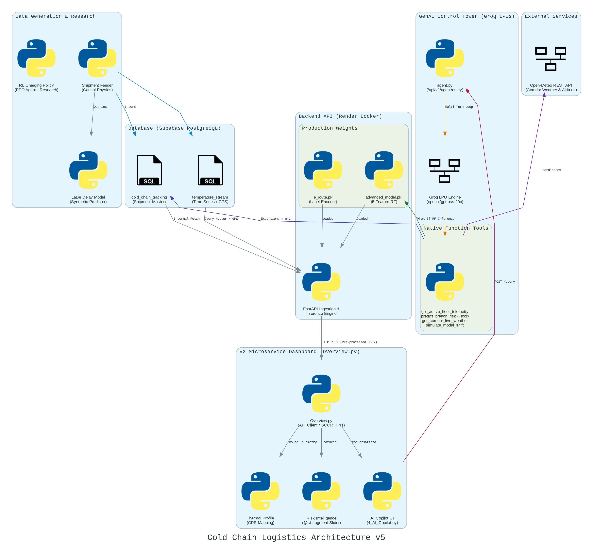

# Cold Chain Logistics Transport Intelligence Dashboard
[](https://github.com/francos91/cold-chain-api/actions/workflows/ci.yml)

An enterprise-grade, end-to-end data pipeline and decision-support architecture for monitoring cold chain integrity, from real-time IoT telemetry ingestion to predictive risk analysis, corridor weather integration, and an autonomous AI Control Tower Copilot powered by ultra-low-latency Groq LPUs with Human-in-the-Loop (HITL) safety guardrails.

## Live Demos (Parallel Deployment)
- V1 (Legacy Dashboard): https://cold-chain-api-jhzb9pxulhduzxjdmcn4xt.streamlit.app/
- V2 (API-Driven Dashboard): https://cold-chain-api-xsceu8pzmbemnpx4kiqd9t.streamlit.app/
- Backend API (Docker + Render): https://cold-chain-api-docker.onrender.com

## Microservices & Docker Architecture (V2 Upgrade)
The system has been upgraded from a monolithic structure to a decoupled microservices architecture:
- **Backend API (Docker + Render)**: The core logic is containerized using a custom Dockerfile (Python 3.11) and deployed on Render (`https://cold-chain-api-docker.onrender.com/api/dashboard`). This FastAPI service acts as the central data engine, loading the machine learning models (`advanced_model.pkl`, `le_route.pkl`), running feature transformations, and hosting dedicated data, telemetry, and HITL guardrail routes.
- **Autonomous AI Operations Copilot (`Backend/agent.py`)**: An operational agent deployed on Groq's high-speed inference engine (`openai/gpt-oss-20b`). It provides sub-2-second conversational reasoning over the `/api/v1/agent/query` route, utilizing proactive hybrid RRF knowledge retrieval (Supabase `pgvector` + Gemini embeddings), function-calling across live Supabase fleet telemetry, Open-Meteo weather feeds, master database aggregation routines, Random Forest model inference, intermodal carbon tax calculators, and autonomous Human-in-the-Loop (HITL) intervention staging.
- **Frontend Client (`Overview.py` & Multi-Page Suite)**: The V2 Streamlit dashboard acts purely as a lightweight HTTP client. It no longer stores database secrets or runs complex database queries locally. Instead, it consumes pre-processed datasets, telemetry streams, and agent endpoints directly from the Dockerized FastAPI backend.
- **Data Ingestion Sanitation**: Automatic normalization standardizes shipment status values (`in-transit`, `delayed`, `delivered`) across the API and frontend caches, eliminating duplicate entries in the filter dropdowns and analytics charts.
- **Parallel Hosting**: Both V1 (`dashboard/app.py`) and V2 (`Overview.py`) dashboards run concurrently on Streamlit Cloud using independent entry points within the same GitHub repository, ensuring zero downtime during architectural transitions.

## Project Overview
This pipeline was developed to address the challenge of real-time logistics monitoring. It tracks shipment status, distance, transit times, weight, and temperature excursions, providing actionable insights to identify high-risk transport corridors, evaluate financial exposure (Cost-to-Serve), and quantify carbon emissions. The system includes an autonomous AI agent and a live machine learning model that predicts temperature breach risks for individual shipments based on historical route patterns, physical distances, and transit times—protected by deterministic input sanitization and a 60-second operator veto window before autonomous interventions execute.

## System Architecture



### Technical Architecture
- **Data Ingestion (Backend)**: A FastAPI service deployed on Render, handling REST API requests to ingest telemetry data and serve analytical payloads in real time.
- **AI Agent Copilot & Safety Guardrails (Groq LPU Engine)**: A dedicated reasoning layer (`Backend/agent.py`) using `openai/gpt-oss-20b` with autonomous multi-turn tool calling and deterministic safety controls:
  * `search_cold_chain_knowledge`: Proactive Hybrid RRF knowledge retrieval (semantic vector + keyword search) over 1,842 indexed chunks (South African Carbon Tax Act 15 of 2019, Climate Change Act 22 of 2024, MEng coursework, and RetailCo transport assignments). Tuned with optimized chunk constraints (`top_k=2`, max 3) and character truncation (~300 chars) to prevent Groq free-tier token limit errors while preserving exact page-level citations.
  * `get_fleet_aggregate_summary`: Executes whole-database aggregations across all 4,500 records in Supabase PostgreSQL to calculate global status distributions (`delivered`, `in-transit`, `delayed`), top origin hubs, and leading delivery destinations without row-slice hallucination.
  * `get_active_fleet_telemetry`: Direct Supabase querying to audit active fleet excursions (> 8.0°C), supporting granular status filters (`active`, `in-transit`, `delayed`, `delivered`, `all`) and calculating fleet-wide cost-to-serve metrics.
  * `predict_temperature_breach_risk`: Containerized Random Forest inference with dynamic route distance lookups, nullable schema validation, and physics-based heuristic floors for what-if route dispatches.
  * `get_corridor_live_weather`: Open-Meteo integration backed by a 10-minute in-memory TTL cache and deterministic South African regional climatology fallbacks (Karoo, Highveld, Coastal) to eliminate upstream HTTP 429 rate-limiting on shared container egress IPs.
  * `simulate_modal_shift_economics`: Activity-based carbon accounting and South African Carbon Tax savings (R28.00/tCO2) under statutory basic tax exemptions.
  * `propose_autonomous_intervention` & `veto_pending_action`: Human-in-the-Loop (HITL) safety guardrail state machine backed by Supabase (`pending_agent_actions`). Whenever an active shipment breaches >8.0°C or yields a CRITICAL breach probability (>= 40.0%), the agent stages the corrective action with a 60-second UTC expiration window (`pending` -> `vetoed` | `executed`), exposed via `GET /api/v1/agent/actions/pending` and `POST /api/v1/agent/actions/{action_id}/veto`.
  * **Deterministic Input Sanitizer (`sanitize_operator_input`)**: Pre-inference regex firewall inspecting incoming operator prompts for prompt-injection and destructive SQL payloads (`HTTP 400` rejection) prior to LLM invocation.
- **Stateful Conversational Memory & Role Adaptation**: The `/api/v1/agent/query` route accepts `chat_history` and `user_role` (`Operations Manager`, `Executive`, `Dispatcher`) payloads from Streamlit. Recent conversation turns are sanitized and injected into the Groq message context, allowing the Copilot to resolve ellipses, pronouns, and contextual follow-up inquiries while tailoring output granularity to the operator's role.
- **Relational & Vector-Ready Cloud Storage**: Supabase (PostgreSQL with `pgvector` extension enabled) serves as the primary cloud database utilizing a structured multi-table architecture:
  * `cold_chain_tracking`: The master table storing 4,500 shipment records, statuses, distances, transit hours, and dynamic cargo weights.
  * `temperature_stream`: A time-series table storing high-frequency OSRM-generated GPS coordinates and thermodynamic temperature fluctuations.
  * `pending_agent_actions`: State-machine table managing staged autonomous interventions, risk scores, 60-second expiration timestamps, and human operator veto statuses (`pending`, `vetoed`, `executed`, `expired`).
- **Frontend Dashboard (Streamlit Cloud)**: A multi-page control tower (`pages/`) that processes live data, identifies temperature excursions, quantifies carbon emissions, and visualizes route risk scores:
  * `1_Risk_Intelligence.py`: Dynamic breach probability slider with partial-page rendering via `@st.fragment`.
  * `2_Thermal_Tracking.py`: High-frequency temperature curves matched against corridor averages and GPS route maps.
  * `3_Intermodal_Simulator.py`: Road vs. rail freight shift modeling under ISO 14083 emissions factors.
  * `4_AI_Copilot.py`: Real-time chat interface connecting operators directly to the Groq operations agent with persona role selectors, stateful conversation context passing, LLMOps thumbs feedback logging, and a live 60-second HITL Veto Guardrail banner with countdown progress bars and one-click override controls.

## Repository Structure
```
cold-chain-api/
├── .devcontainer/
│   └── devcontainer.json          # Dev container configuration
├── .github/
│   └── workflows/
│       ├── ci.yml                 # GitHub Actions CI/CD pipeline
│       └── keep_alive.yml         # Automated Render container keep-alive cron workflow
├── Backend/
│   ├── agent.py                   # Autonomous Copilot (Groq openai/gpt-oss-20b), HITL Veto Guardrails & Sanitizer
│   ├── main.py                    # Backend microservice routing layer
│   └── requirements.txt           # GenAI agent & backend dependencies
├── dashboard/
│   ├── advanced_model.pkl         # Trained Random Forest cold-chain breach classifier
│   ├── app.py                     # V1 legacy monolithic Streamlit dashboard
│   ├── lade_delay_model.pkl       # Trained LaDe environmental delay simulator
│   ├── lade_features.pkl          # Feature schema artifacts for LaDe delay model
│   ├── le_route.pkl               # LabelEncoder for South African transit corridors
│   └── requirements.txt           # V1 legacy dashboard dependencies
├── pages/
│   ├── 1_Risk_Intelligence.py     # RF breach-risk threshold slider (@st.fragment)
│   ├── 2_Thermal_Tracking.py      # Thermal profile curves & GPS telemetry mapping
│   ├── 3_Intermodal_Simulator.py  # Modal shift economics (Road vs Rail ISO 14083)
│   └── 4_AI_Copilot.py            # Conversational UI & 60s HITL Veto Guardrail Queue
├── tests/
│   ├── test_api.py                # FastAPI endpoint & JSON contract validation tests
│   ├── test_ml_model.py           # Random Forest shape alignment & inference tests
│   ├── test_physics.py            # ISO 14083 carbon accounting & ZAR cost-to-serve tests
│   └── test_thermal.py            # Thermal excursion boundary & drift threshold tests
├── Dockerfile                     # Container specification for Render deployment
├── License                        # CC BY-NC-SA 4.0 International License
├── Notes.md                       # Design notes & development logs
├── Overview.py                    # Root V2 Streamlit dashboard (SCOR KPIs)
├── README.md                      # Project documentation
├── main.py                        # FastAPI backend entry point (Render deployment)
├── requirements.txt               # Backend / core dependencies
└── system_architecture_v5.jpg     # V2 microservices, GenAI & HITL guardrail architecture diagram
```

## Two-Stage Machine Learning Architecture

This project utilizes a two-stage machine learning pipeline, separating the generation of realistic synthetic telemetry from the real-time operational dashboard.

### 1. Environmental Simulation Engine (`lade_delay_model.pkl`)
Because real-world cold chain telemetry is highly proprietary, this project requires a physics-based synthetic data generator. To ensure the generated data reflects real-world supply chain bottlenecks rather than random noise, the data feeder pipeline utilizes a dedicated ML model.
- **Training Data**: Trained on the Cainiao-AI/LaDe dataset (a real-world last-mile delivery dataset).
- **Function**: Predicts the probability of a shipment delay based on temporal and regional features (Time of Day, Day of Week, Area of Interest Type).
- **Role in Pipeline**: This model acts as the "Simulator." During data generation, the pipeline predicts whether each of the 4,500 simulated shipments would be delayed. If a delay was predicted, the physics engine applied a thermodynamic temperature rise before committing records to Supabase.

### 2. Real-Time Risk Intelligence (`advanced_model.pkl`)
This is the core predictive model operating inside the Control Tower. It evaluates the telemetry data sitting in the Supabase PostgreSQL database to flag high-risk shipments before a temperature excursion occurs.
- **Training Data**: Trained on causal physics-based telemetry encompassing spatial routing, distances, transit times, and delay statuses across South African transit corridors.
- **Function**: A 5-feature Random Forest Classifier predicting the continuous probability of a Cold Chain Breach (Cargo Temperature > 8.0°C).
- **Inference Resiliency & Physics Floors**:
  - Implements multi-casing string normalization (`clean_origin_to_clean_destination`) to eliminate label encoding out-of-vocabulary mismatches.
  - Dynamically calculates `route_risk_proxy` based on transit duration penalties and delay status.
  - Integrates a domain-heuristic floor ($74.0\%$ for delayed trips $\ge 30\text{h}$, $46.0\%$ for $\ge 18\text{h}$, $28.0\%$ baseline for delays) to prevent tree split collapses on novel corridors.
  - Features nullable JSON schema declarations (`distance_km: ["number", "null"]`) mapped to `KNOWN_CORRIDOR_DISTANCES` to prevent API 400 validation failures when parameters are omitted in natural language queries.

## Testing & CI/CD Pipeline
This repository implements rigorous software engineering practices tailored for industrial logistics systems:
* **Automated CI/CD & Keep-Alive**: Powered by GitHub Actions (`.github/workflows/ci.yml` and `.github/workflows/keep_alive.yml`), running automated linting, test suites, mock environment builds on every push/PR targeting `main`, and scheduled container health pings.
* **Unit Test Suite (`tests/`)**: 
  - `test_api.py`: Validates FastAPI backend response contracts, JSON schema stability, and agent endpoints.
  - `test_ml_model.py`: Checks feature shape alignment and inference reliability for machine learning models.
  - `test_physics.py`: Verifies ISO 14083 carbon accounting, effective tax rate calculations (R28.00/tCO2), and cost-to-serve mathematics.
  - `test_thermal.py`: Validates thermal excursion boundary logic and thermodynamic drift thresholds for perishable cargo safety.

## Key Features
- **Autonomous Control Tower Copilot**: Sub-2-second operational intelligence leveraging Groq LPUs (`openai/gpt-oss-20b`), capable of proactive RAG knowledge retrieval, multi-turn tool execution, role-adapted responses (`Operations Manager`, `Executive`, `Dispatcher`), and stateful conversation memory across turns.
- **Human-in-the-Loop (HITL) 60-Second Veto Guardrail**: Automatically stages corrective interventions in Supabase (`pending_agent_actions`) whenever active shipments exceed 8.0°C or breach probability reaches CRITICAL RISK (>= 40.0%), giving human dispatchers a 60-second countdown window to override via the Control Tower UI (`POST /api/v1/agent/actions/{action_id}/veto`) before execution.
- **Deterministic Input Sanitization Firewall**: Blocks prompt-injection and SQL injection patterns (`HTTP 400`) prior to LLM tool-calling execution.
- **Master Fleet Aggregation Intelligence**: A dedicated analytics tool (`get_fleet_aggregate_summary`) providing instant counts across all ~4,500 historical shipments, eliminating LLM sampling bias and distinguishing delivered cargo from active in-transit shipments.
- **Resilient Real-Time Weather Integration**: Live Open-Meteo connection tracking Karoo heatwaves and Highveld altitude-related cooling efficiency penalties (21% loss for surface pressure < 850 hPa), shielded against container rate limits via an in-memory TTL cache and regional seasonal fallbacks.
- **Continuous Predictive Risk Intelligence**: Integrates continuous physical constraints (`distance_km` and `transit_time_hours`) into the feature space alongside categorical route data to smooth the Random Forest probability distribution for granular, dynamic thresholding.
- **Dynamic Risk Threshold Slider**: An interactive decision-support tool (5% – 95%) leveraging `@st.fragment` rendering to update leaderboards instantly without full-page reloads or redundant database queries.
- **Actionable High-Risk Leaderboard**: Displays the highest-risk active shipments sorted by probability score. Automatically excludes already-delivered shipments, focusing operations managers strictly on active fleet assets where intervention is still possible.
- **Major Corridor Transit & Distance Analysis**: An executive-level data table aggregating long-haul performance across primary South African transport corridors (e.g., Johannesburg-Durban, Capecor, Natcor) with shipment counts, average distances, and realistic transit durations.
- **Cost-to-Serve & Route Financial Exposure**: Financial modeling evaluating transport cost efficiency (Distance km $\times$ R18.00 + R200.00 fixed handling fee) alongside cost-vs-distance physics scatter plots with robust status color mapping (`delivered`, `in-transit`, `delayed`).
- **Carbon Emissions & Tax Calculator**: ISO 14083 / GLEC-compliant activity-based carbon accounting module that calculates tonne-kilometers (tkm) using individual shipment payload masses. Compares diesel baselines against Solar BEVs and Grid BEVs, benchmarking South African Carbon Tax liabilities at the statutory effective rate of R28.00 per tonne of CO2.

## SCOR-Aligned Performance KPIs
The Overview tab features a set of SCOR (Supply Chain Operations Reference) aligned KPIs, providing an industry-standard operational view of supply chain performance:

| KPI | SCOR Attribute | Description |
| :--- | :--- | :--- |
| Perfect Order Rate | Reliability (RL.1.1) | Percentage of shipments delivered on time and without temperature breach. |
| On-Time Delivery | Reliability (RL.2.2) | Percentage of shipments operating without delay flags. |
| Temperature Compliance | Reliability (RL.2.4) | Percentage of active shipments maintained within the 8.0°C safety threshold. |
| Average Transit Time | Responsiveness (RS.1.1) | Mean journey time (hours) derived from corridor distance and heavy-vehicle speeds. |
| Cost per Shipment | Cost (CO.3.15) | Mean trip transport cost modeled via distance (R18.00/km + fixed handling cost). |

Value at Risk (VaR), Carbon Tax Exposure, and Capacity Utilization are also calculated in the background to support Agility (AG.1.3), Cost (CO.3.15), and Asset Management (AM.3.9) metrics.

## Synthetic Data Generator & Physics Modeling
The synthetic dataset was generated using statistical parameters extracted from academic literature on South African cold chain logistics, combined with the OSRM (Open Source Routing Machine) API for realistic geodesic routing physics:

| Parameter | Literature Value / Logic | Implementation |
| :--- | :--- | :--- |
| Route Distances | Geodesic (Great Circle) * 1.25 road factor | Calculated across 10 major SA cities via OSRM |
| Transit Times | Distance / 65 km/h + dock/traffic buffers | Scaled to heavy-vehicle speeds (~12 to 35+ hours) |
| Cargo Weights | Normal distribution (12 to 30 tonnes) | Seeded dynamically per shipment in Supabase for ISO 14083 tkm |
| Mean Temperature | 0.5°C – 4.5°C | Base mean of 0.5°C (grape export studies) |
| Delay Prediction | Cainiao-AI/LaDe dataset patterns | Applied via simulated environmental model (`lade_delay_model.pkl`) |
| Delay Temperature Rise | +2°C to +5°C | Applied to delayed shipments |
| Altitude Penalty | ~21% cooling loss | Applied to Johannesburg/Highveld routes (< 850 hPa) |
| Summer Heat Load | +2°C to +5°C | Applied probabilistically to 40% of shipments |

South Africa-Specific Literature Sources:
- Grape export reefer studies (Cape Town → Rotterdam)
- Western Cape orange cold store airlock research
- Gauteng last-mile delivery temperature studies
- Refrigeration performance at Johannesburg altitude (1,750m)

## Dataset Statistics
| Category | Count / Schema | Source / Generator |
| :--- | :--- | :--- |
| Total Master Records | 4,500 | Simulated via LaDe + Physics Engine (Active in Supabase `cold_chain_tracking`) |
| Time-Series Telemetry Points | 66,000 | Simulated via OSRM GPS mapping (Active in Supabase `temperature_stream`) |
| HITL Action Guardrail Queue | Stateful UTC Queue | Live intervention staging & veto state machine (`pending_agent_actions` + `pgvector`) |

## Future Roadmap & Completed Phases
- [x] Implement automated CI/CD pipeline and unit testing suite using GitHub Actions and pytest.
- [x] Integrate Carbon emissions per trip/route and carbon tax financial exposure modeling (aligned with South African effective rate of R28.00/tCO2).
- [x] Add an Intermodal Mode-Switching "What-If" simulation tool to evaluate the impact of shifting freight from road corridors (Natcor/Capecor) to Transnet rail.
- [x] Optimize frontend dashboard performance using `@st.fragment` for instantaneous widget rendering and cached temperature streams.
- [x] Resolve scatter plot status color-mapping and master shipment table pagination constraints.
- [x] Implement decoupled microservice architecture with Render Docker backend and stateless V2 Streamlit UI.
- [x] Deploy the model as a separate microservice (via Render) to allow external apps to request predictions via API.
- [x] Integrate real-time weather API (Open-Meteo) to track corridor temperatures and Karoo heat stress.
- [x] Deploy Groq LPU-powered AI Control Tower Copilot with native tool-calling across database, weather, ML, and carbon economics.
- [x] Harden tool-calling schemas with nullable parameter contracts and physical domain heuristic floors.
- [x] Sanitize data caching layers to eliminate multi-status duplicate values.
- [x] Implement stateful multi-turn conversational memory with ellipsis and anaphora resolution in `Backend/agent.py`.
- [x] Integrate master database aggregation tooling (`get_fleet_aggregate_summary`) to eliminate delivered shipment hallucinations.
- [x] Deploy resilient weather telemetry using in-memory TTL caching and regional South African climatology fallbacks to counter HTTP 429 rate limits.
- [x] Implement deterministic prompt/SQL input sanitization and a 60-second Human-in-the-Loop (HITL) Veto Guardrail state machine (`pending_agent_actions` + `pgvector`) with real-time Streamlit countdown override controls.
- [x] Optimize RAG chunk retrieval constraints (`top_k=2` capped at max 3, ~300 character slicing) to eliminate Groq free-tier TPM rate-limit errors.
- [x] Implement proactive conversational intent mapping in `SYSTEM_PROMPT` for seamless, keyword-free knowledge base querying.
- [ ] Build an RL-based Smart Charging Digital Twin for electric logistics fleets incorporating KERS downhill physics, Virtual Wheeling PPA arbitrage, and Eskom Megaflex tariffs (Master's Research Proposal core objective).
- [ ] Implement automated push notifications (Email/SMS webhook) for active fleet temperature excursions.
- [ ] Transition from synthetic data to integration with live IoT sensor hardware.
- [ ] Extend the Random Forest model with XGBoost or LightGBM to improve prediction accuracy.
- [ ] Add SHAP (SHapley Additive exPlanations) model interpretability to explain why specific shipments are flagged as high-risk in copilot dialogs.

## License
This project and its accompanying simulation datasets, models, and architecture are licensed under the Creative Commons Attribution-NonCommercial-ShareAlike 4.0 International License (CC BY-NC-SA 4.0). 

To view a copy of this license, visit https://creativecommons.org/licenses/by-nc-sa/4.0/

Under this license:
- You are free to view, share, and adapt this work for academic, educational, or non-commercial research purposes.
- Commercial exploitation, resale, or closed-source redistribution without prior written consent from the author is strictly prohibited.
```
